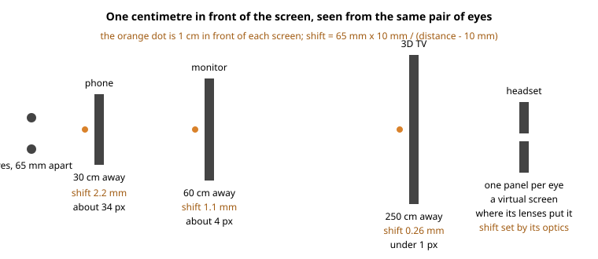

# Centimetres, pixels and where a model sits in depth

**Status:** an individual's input to the Procedural Memory Knowledge Representation Community Group, by Daniel Campos Ramos, 6 November 2026.
It is not a decision or a report of the group.
Comments and objections are welcome in this repository's issues.
**Why in PM-KR:** a knowledge representation of a 3D object must carry its size in physical units, its placement in depth and the resolution each eye is drawn at as three separate facts, so that a program or a model can act on each without confusing them.

## The question

The [CSS Spatial Layout](https://github.com/WebKit/explainers/blob/main/css-spatial/explainer.md) draft, by Ada Rose Cannon and Elika J. Etemad (fantasai) of Apple, brings depth to web pages: `spatial: page` raises content toward the person, `spatial: portal` opens a window into a 3D world behind the page, `inset-back` and `inset-front` move a box along the z-axis in centimetres, and a `front-limit` the browser chooses caps how far content may come out.
Two threads in WebKit's explainers repository discuss it:

- [#147](https://github.com/WebKit/explainers/issues/147), where khufu-dev asked for a CSS `depth` property to set how deep a 3D model goes, "similar to width and height";
- [#163](https://github.com/WebKit/explainers/issues/163), where I asked for depth limits the person sets, plain depth words, and stereo images shown in a spatial page.

Reading both, three different things are easy to confuse: how big a model is, how sharply it is drawn, and where it sits in depth.
Under them is one question: what a centimetre means on a screen.

## Three things, three units

1. **The model's own size: width, height and thickness.**
   A length of the scene in front of the camera, like the sides of a box.
   Centimetres fit it, and the draft already measures the portal's stage that way (`portal-stage: 10cm 8cm / 15cm 2cm`), with `portal-transform: none` keeping one centimetre behind the glass equal to one centimetre on the page.
   The thickness khufu-dev asked for is this kind of length.
   Today `width` and `height` have no effect on model content, so neither would `depth`; fantasai suggests making them act as they do for images and leaving `depth` to a later level (her comment of 5 November).
2. **The rendering resolution.**
   How many pixels each eye's view of the model is drawn with: a quality setting, and on a stereo display a setting per eye.
   It is not the display's resolution; the browser scales the rendered view once into the box the page gives it.
   The desktop calls the same thing [render resolution per eye](../glossary/README.md#render-resolution-per-eye), the one stereo option a program needs.
3. **Where the model's box sits in depth.**
   Behind the glass, on it, or in front of it: a position, not a length.
   Nothing in the draft says it for a model.
   Its user agent style sheet keeps every model behind its own glass (`model, spatialfigure { spatial: portal; front-limit: 0 !important; }`, in the draft's source), and an author may want one model sunk, another at the screen and a third popped, on the same page, with ordinary elements placed the same way.

## Why a centimetre of depth cannot mean the same thing everywhere

On a screen, depth is parallax: the shift between the two eyes' copies of a point, counted in pixels of a view ([Stereo 3D: two views, one depth](stereo-3d.md)).
Putting a point one centimetre in front of the screen needs a shift on the screen of eye separation × 1 cm ÷ (viewing distance − 1 cm), with the eyes about 65 mm apart ([camera geometry](https://github.com/danielcamposramos/awesome-stereoscopy/blob/main/docs/stereo-camera-geometry.md)).

- A phone 30 cm from the eyes: a shift of 2.2 mm, about 34 pixels on a 1080-pixel-wide phone screen.
- A monitor at 60 cm: 1.1 mm, about 4 pixels at 1920 wide.
- A 3D TV at 2.5 m: 0.26 mm, under one pixel at 1920 wide; two pixels on the same set would be five centimetres.
- A headset: no screen at a distance at all.
  Each eye has its own panel, and the lenses place a virtual screen where the maker's optics put it, so the shift is set by the optics.

So the same centimetre is a large shift on a phone, a few pixels on a monitor and less than a pixel on a television, and twice as many pixels on a 4K set as on a 1080p set of the same size.
No display announces the viewing distance: a Wayland output reports its physical width and height in millimetres, its make and its model, and may report zero for a projector (`wl_output.geometry`), and nothing reports where the person sits.
Comfort differs between people and between displays too: a headset tolerates more separation, a framed 3D screen wants less.
So neither an author nor a browser can turn a length in front of the page into a shift from the display alone.
Centimetres fit a camera's scene; a page element's depth is a fraction of what this person accepts on this display.

## The answer: three words and a fraction, resolved per display

`sunk | screen | popped | <percentage> | <number>`: `popped` is the person's front limit on this display, `sunk` their back limit, `screen` the page plane; a percentage, or a number between 0 and 1, is that fraction of the limit on its side, so `popped` at 50% is half the front limit ([Depth on a desktop and on a page](depth-sunk-screen-popped.md)).
The person sets the two limits once, at the system, and every window and page follows them; the browser reads them as it already reads the colour scheme and reduced motion.
A display's kind and size give the default limits, and the person's own setting, where there is one, replaces them.
That is how it works on Sparky Stereo OS, a Linux desktop where windows, menus and theme elements already sit at these depths; "the desktop" below means that system.

**The mapping to the draft, and why "popped" is `inset-back`.**
The draft names its z-axis insets the way CSS names `top` and `bottom`: each is a distance measured from that side, pushing the box away from it.
`inset-back` is measured from the page plane, the back of the space in front of the page, so a positive value pushes the box toward the person; the draft's own example raises text with `inset-back: 1cm`.
`inset-front` is measured from the front and pushes the box into the page, and for relative positioning it computes to the negative of `inset-back`.
A percentage resolves "relative to the distance from the containing block to the front limit plane" (the draft's "Z-axis Insets" section).
So `popped` is `inset-back: 100%`.
The name says where the distance is measured from, not where the box goes, which is one reason plain words such as sunk, screen and popped help people.
My issue of 4 November had it backwards, as `inset-front: 100%`; the correction is posted on #163 ([comment of 6 November](https://github.com/WebKit/explainers/issues/163#issuecomment-6694348852)), asking the editors to confirm.
`sunk` would be `inset-front` against a back limit, and the draft has none: the back spatial context's allowed volume is "infinite and unlimited", and under `spatial: page` anything below the page plane is clamped to the page.
A back limit, for `spatial: page` as well as `spatial: portal`, is the first suggestion of #163.

## Overlap: keeping models and text readable

When two things overlap on the page at different depths, the eyes get two cues, who covers whom and how far apart the two copies are, and the picture only reads when the cues agree.

- **Depth agrees with painting order.**
  Nothing painted over another thing sits behind it in depth.
  The desktop keeps this rule even for declared depths: a widget declared popped stays sunk while a window lies on top of it, and takes its own level only when nothing overlaps it.
  The draft composites boxes clamped at a limit "as if the z-axis distance between them were compressed to an infinitesimal amount", which keeps their order; the same must hold for boxes that are not clamped.
- **Text takes its element's plane.**
  A label anchored to a model, as in the draft's example of a name tag on a teapot, sits at the model's point and reads well.
  A caption at the page plane lying across a popped model does not, so it takes the model's depth or sits beside it.
- **Edges.**
  A popped thing cut by the edge of the viewport or the window looks wrong; a sunk thing cut by the edge reads like a view through a window.
  The desktop keeps anything touching the output's edge at the screen plane and places popups at least 10 pixels inside the edges of a 3D output (built on 6 November 2026, coming in the next update); a page in full screen needs the same, and the draft's pulling content back when a dialog opens is a rule of the same kind.
- **The limits cap the pile.**
  A stack of popped models never passes the front limit and a pile of sunk ones never passes the back limit; between the limits, things fit by their order.

## What the draft could take from this

1. `sunk`, `screen` and `popped` as keywords of the z-axis insets, resolved per display.
2. A back limit beside the front limit.
3. The limits from the person's system setting where one exists, over the browser's default.
4. For a model: centimetres for its size, as the draft already does for the scene; the three words for where its box sits.
5. A picture whose file declares a stereo pair shown with each view to its eye, at the plane of the picture's box.

## Where it exists today

- The three words and the per-display limits are built in the desktop's compositor and seen on a 3D TV on 13 October 2026 ([Depth on the desktop](https://github.com/Sparky-OS/sparky-stereo-os/blob/main/docs/depth-on-the-desktop.md)); the compositor hands each window the depth limits of the output it sits on, and the desktop's browser build of November 2026 reads them, drawing a page flat on a 2D output ([Sparky-OS/waterfox](https://github.com/Sparky-OS/waterfox), branch `stereo3d`).
- The same words in SVG: [SVGStereo, DEPTH.md](https://github.com/Sparky-OS/svgstereo/blob/main/DEPTH.md).
- Media queries for stereoscopic displays are discussed in the CSS Working Group ([csswg-drafts #13119](https://github.com/w3c/csswg-drafts/issues/13119)).

## Earlier work

W3C's 2012 Stereoscopic 3D Web Task Force proposed `perspective-baseline` among its CSS properties for pages "rendered in stereoscopic 3D on a 3D display" ([editor's draft, 30 November 2012](https://www.w3.org/2011/webtv/3dweb/3dweb_proposal_121130.html)), and the Stereoscopic 3D Web Community Group that followed studied how people perceive stereoscopic pages; both are recorded in the first [stereo report](https://www.w3.org/publications/spec-generator/?type=respec&url=https://raw.githubusercontent.com/w3c-cg/pm-kr/main/reports/source/stereo-3d-adoption-report.html), "Twice at W3C".

## Questions for the group

1. Should the z-axis insets take the three words, resolved against each display's limits?
2. Should a back limit exist, and where should the person set both?
3. For a model: centimetres for its size and the three words for its place, or one unit for both?
