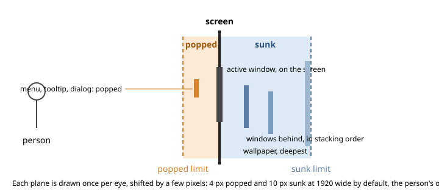

# Depth on a desktop and on a page: sunk, screen, popped

**Status:** an individual's input to the Procedural Memory Knowledge Representation Community Group, by Daniel Campos Ramos, 6 November 2026.
It is not a decision or a report of the group.
Comments and objections are welcome in this repository's issues.
**Why in PM-KR:** a depth is a fact about an element that a theme, a desktop, a drawing and a page each describe in their own words today, so three plain words and the person's limits are the form in which that fact can be stored once and resolved by any renderer.

## The question

Desktops and web pages already fake depth: shadows under the focused window, dimmed windows behind it, lifted menus, raised buttons, Material's "elevation" in dp.
On a stereo screen that cue can be real.
The question is how to say it so that the same declaration holds on a 3D TV, a headset, a glasses-free screen and a monitor with red and cyan glasses, for every person, and leaves a 2D screen exactly as it was.

## The idea

Three places, declared in three plain words: **sunk**, **screen** and **popped**.
All subtle, a few pixels of parallax, within limits the person sets.

- The active window sits at the screen.
  Its menus, tooltips, dialogs and notifications pop.
  The windows behind sink, in their stacking order, and the wallpaper is deepest.
- Everything in between is the compositor's job, by order: stacked background windows fan out from sunk toward the screen, always behind the active window, the way a pile of papers looks.
- Each element is drawn once per eye and shifted by its own depth; its text, and its click area, move with it.
  Text written in the same plane as its element reads fine; what tires the eyes is flat text lying over a picture at another depth.
- Inside the active window, buttons, fields, tabs and rows move by a pixel or less from the window's surface, the theme's shadows giving the sign and the strength: an outer shadow pops, an inset sinks.
- On a 2D screen the same desktop shows unchanged, with the ordinary 2D effects.

**The limits are the person's, resolved per display.**
Sunk and popped are two limits; anything between them is valid, nothing beyond.
The defaults are 4 pixels popped and 10 pixels sunk at 1920 pixels wide, scaled for each output, set once in System Settings and read by every program.
The back needs the larger range: a popped thing cut by the screen's edge looks wrong, a sunk thing seen through the edge reads like a view through a window.
So anything that touches the output's edge stays at the screen plane (the stereo window), and on outputs that show 3D, popups are placed at least 10 pixels inside the edges so they keep their pop (built on 6 November 2026 and coming in the next update; a plain 2D screen is unchanged).
The order of precedence is the person's choice first, built on the current display's default: a headset tolerates more separation, a framed 3D screen wants less, and both show a coherent picture.

## The same names everywhere

The vocabulary is `sunk | screen | popped | <percentage> | <number>`, a percentage being a fraction of the limit on its side ([glossary](../glossary/README.md#the-three-planes-sunk-screen-popped)).
It is used, under those words, in:

- the desktop's compositor (Stereo KWin, `SunkLimit`, `PoppedLimit`, `ElementLimit` in `kwinrc`);
- the theme engine's model (Stereo Union's `depth:`, the edition's fork of KDE's Union, with finished work to offer upstream);
- SVG drawings ([SVGStereo, DEPTH.md](https://github.com/Sparky-OS/svgstereo/blob/main/DEPTH.md)), where the reader doubles a single-view drawing and evaluates its gradients and animation per view;
- a proposal for CSS ([WebKit/explainers #163](https://github.com/WebKit/explainers/issues/163)), discussed in [Centimetres, pixels and where a model sits in depth](centimetres-and-model-depth.md).

Older vocabularies already say the same thing without stereo: Qt's `QFrame::Shadow` is `Plain`, `Raised` or `Sunken`, and Material Design's elevation is a distance between surfaces on the z-axis.
A 2D theme already encodes 3D; the three words only show it.

## Where it exists today

- Shipped in the edition's compositor and seen on a 3D TV on 13 October 2026, measured on the capture: the focused popup at +4 pixels, the windows behind at −3, −7 and −10 ([Depth on the desktop](https://github.com/Sparky-OS/sparky-stereo-os/blob/main/docs/depth-on-the-desktop.md), [Depth inside every window](https://github.com/Sparky-OS/sparky-stereo-os/blob/main/docs/depth-inside-windows.md)).
- A KDE user with his own red and cyan glasses, on the design thread: "it's really quite remarkable how much physical pop/push you appear to get with only a few pixels. it's like looking at 2" deep picture box" ([KDE Discuss, 13 October 2026](https://discuss.kde.org/t/real-depth-for-oceans-elevation-a-design-question-for-union/50744/16)).
- Measured before us: Diego González-Zúñiga's thesis (UAB, 2016) used depth on ordinary interfaces to imply importance and hierarchy, and found grouping by depth made a memory task faster.

## Earlier work

The Compiz anaglyph plugin of 2007 drew every window twice in red and cyan, shifted by its role: the desktop behind, ordinary windows at the screen, the active and keep-above windows in front; no distribution shipped it by default ([awesome-stereoscopy](https://github.com/danielcamposramos/awesome-stereoscopy#desktops-drawn-in-3d-2004-to-2012)).
The 2012 Stereoscopic 3D Web Task Force proposed a `perspective-baseline` property; none of its properties entered CSS.

## Questions for the group

1. Would the three words fit your toolkit's existing raised and sunken states?
2. Where should a person set their limits once, so that every program on that screen follows?
