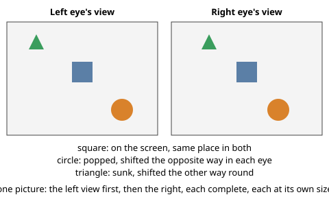
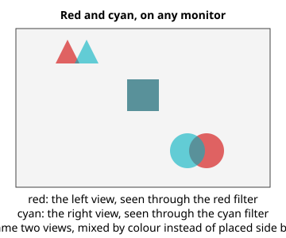

# Stereo 3D: two views, one depth

**Status:** an individual's input to the Procedural Memory Knowledge Representation Community Group, by Daniel Campos Ramos, 6 November 2026.
It is not a decision or a report of the group.
Comments and objections are welcome in this repository's issues.
**Why in PM-KR:** two views and which eye comes first are one fact about a picture that every format stores in its own way and most programs drop, the duplication the group's charter names, so a representation stored once must carry them under one set of names.

## The question

Your two eyes are about six centimetres apart, so each sees the world from a slightly different place.
Your brain reads the difference between the two views as depth.
A stereo 3D picture is nothing more than that: one picture for the left eye and one for the right, made from two places a few centimetres apart.
Everything else in this subject, every file format, cable and screen, is a way of carrying those two views to the two eyes.

## The idea in one picture

- A thing drawn at the same place in both views sits on the screen.
- A thing shifted the opposite way in each view (to the right in the left view, to the left in the right view) comes out in front of the screen: popped.
- A thing shifted the other way round goes behind the screen: sunk.

The shift between the two views is called parallax, counted in pixels of one view.
Zero at the screen plane, a few pixels either side for a gentle effect (a menu on a stereo desktop pops about four pixels at 1920 pixels wide), more for a strong one.
A pair of red and cyan glasses shows the same two views on any monitor, by colour instead of by place:

## The names, and where they come from

The idea is old and its names are settled; this group reuses them rather than inventing more.

- **View, left and right.** The two pictures. The video standards call them constituent frames and say which is the left view (ITU-T H.264, Annex D, the frame packing arrangement message and its `content_interpretation_type`); Matroska files name them by `StereoMode` ([RFC 9559](https://www.rfc-editor.org/rfc/rfc9559), section 5.1.4.1.28.3, Table 5); PNG files mark a pair with the `sTER` chunk ([PNG Extensions 1.4.0](http://www.libpng.org/pub/png/spec/register/pngext-1.4.0-pdg.html), section 3.6).
- **Left eye first.** The order the two views are written in. Every format has a value for each order, and a wrong declaration shows up as swapped eyes, so every player also lets the person swap them for a file.
- **Parallax and the screen plane.** The horizontal shift of a point between the views, zero at the screen ([the camera geometry page](https://github.com/danielcamposramos/awesome-stereoscopy/blob/main/docs/stereo-camera-geometry.md) in awesome-stereoscopy works it through).
- **Full side by side.** The two views placed next to each other in one picture, left eye first, each complete and at its own size; "full" names how the two views are placed, not how big they are ([glossary](../glossary/README.md#full-side-by-side-at-any-resolution)).

The glossary's [stereo pictures](../glossary/README.md#4-stereo-pictures-views-layouts-and-eye-order) section lists every layout the standards define, side by side, top and bottom, interleaved, time-alternated, anaglyph, and the number each specification gives it.

## Where to read more

[awesome-stereoscopy](https://github.com/danielcamposramos/awesome-stereoscopy) is the reference list behind this explainer: 190 years of the medium with its sources.
Start with:

- [Prehistory: knowing about two eyes](https://github.com/danielcamposramos/awesome-stereoscopy#prehistory-knowing-about-two-eyes), from Euclid's note that the two eyes see different amounts of a sphere to Wheatstone's stereoscope of 1838.
- [How stereo is stored](https://github.com/danielcamposramos/awesome-stereoscopy#how-stereo-is-stored): every file answers one question, where is the second eye.
- [Displays decide the format](https://github.com/danielcamposramos/awesome-stereoscopy#displays-decide-the-format): why side by side, over and under, interleaved and frame-sequential all exist.
- [Who can see it, and who cannot](https://github.com/danielcamposramos/awesome-stereoscopy#who-can-see-it-and-who-cannot): some people see no depth from two views, so a picture must stay readable flat.

## What to try

- Look at the first drawing above and relax your eyes as if looking through the page, parallel rather than crossed, until a third frame appears between the two; in it the circle comes forward and the triangle goes back. The drawing's two frames are about an eye's distance apart on a normal screen, which is what makes this possible.
- Put on red and cyan glasses, red on the left eye, and look at the second drawing on any monitor.
- Open a stereo photo you own (an MPO from a 3D camera or a Nintendo 3DS, a JPS, a side by side JPEG) and find where it says which view is which; the [stereo pictures](../glossary/README.md#4-stereo-pictures-views-layouts-and-eye-order) table tells you what to look for.

## Questions for the group

1. Which of these names does your own work use, and under what name?
2. Where did you last lose the second view: a web page, a photo app, a chat upload?
