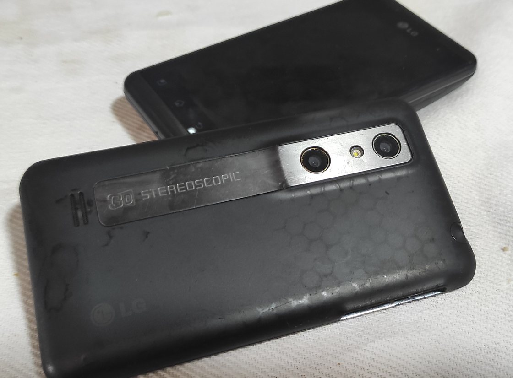
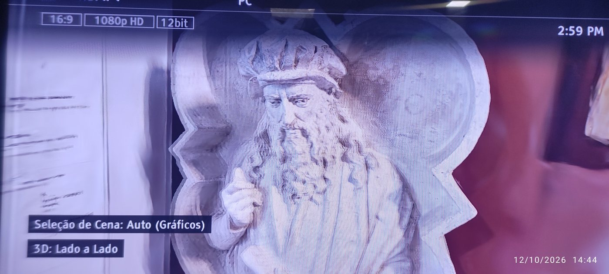
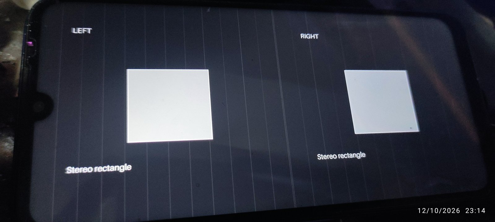
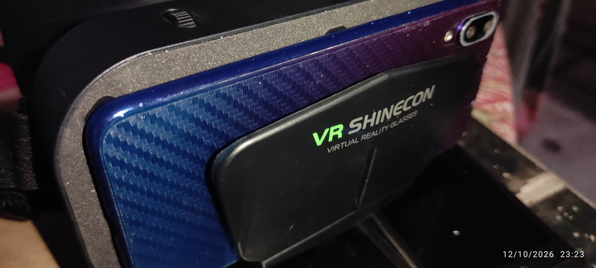

<!-- Input to the PM-KR Community Group from an individual participant. Not a work item or output of the group. -->
> **Status:** input to the PM-KR Community Group from an individual participant, Daniel Campos Ramos, as presented to the W3C Media & Entertainment Interest Group on 13 October 2026 ([minutes](https://www.w3.org/2026/10/13-me-minutes.html)). It is not a work item or output of the group. Licence: CC BY 4.0. The HTML slides: <https://repo.sparkyos.org/talks/2026-10-13-w3c-me-ig/>.

# Stereo 3D: carry the signal to the screen

Slides for the W3C Media & Entertainment Interest Group call, 13 October 2026.
Presented as HTML: <https://repo.sparkyos.org/talks/2026-10-13-w3c-me-ig/> (arrow keys move; a 5, 10 or 15 minute path).

**Paths:** 5 / 10 / 15 minutes · Slide 1

**Daniel Campos Ramos** · Proposed for the Media & Entertainment IG call, 13 October 2026.
**Standing:** my individual proposal, offered as input to the PM-KR Community Group for consideration.
It is not a group decision or a W3C Standard.
[Report: status](https://www.w3.org/publications/spec-generator/?type=respec&url=https://raw.githubusercontent.com/w3c-cg/pm-kr/main/reports/source/stereo-3d-adoption-report.html#sotd)

**Context:** I co-chair PM-KR with Milton Ponson.
Stereo informs that discussion.
[W3C participant record](https://www.w3.org/community/pm-kr/participants)

**Credit:** Dong-Young Lee of LG reviewed the report draft.
[Report: status](https://www.w3.org/publications/spec-generator/?type=respec&url=https://raw.githubusercontent.com/w3c-cg/pm-kr/main/reports/source/stereo-3d-adoption-report.html#sotd)

---

## Why this matters to me

**Paths:** 5 / 10 / 15 minutes · Slide 2

- **My phones:** I took my own stereo photos with these two LG Optimus 3D phones.
- **Today:** their batteries are dead, and I cannot see those photos in 3D.
- **Not for lack of hardware:** I have two 3D screens and two TV boxes whose hidden 3D mode I unlocked.
  None of them could show the photos.
- **So:** I build Sparky Stereo OS, to see them again.

---

## The signal already exists

**Paths:** 5 / 10 / 15 minutes · Slide 3

- **Video:** H.264 and H.265 frame packing SEI describe how views are packed.
  Type 3 is side by side; type 4 is top and bottom.
  [H.264 (2012), D.2.25, Table D-8](https://www.itu.int/rec/T-REC-H.264-201201-S/en) · [H.265 (2021), D.3.16, Table D.8](https://www.itu.int/rec/T-REC-H.265-202108-S/en)
- **Files:** Matroska `StereoMode` identifies packing and eye order.
  [RFC 9559, §5.1.4.1.28.3, Table 5; §18.10](https://www.rfc-editor.org/rfc/rfc9559.html#section-5.1.4.1.28.3)
- **Display links:** HDMI 1.4a specifies 3D formats, including broadcast formats and top and bottom.
  [HDMI Licensing announcement](https://www.hdmi.org/announce/detail/84)
- **Web vocabulary:** WebXR Layers defines `stereo-left-right` and `stereo-top-bottom` for immersive sessions.
  [Layers §2 and §3.2](https://www.w3.org/TR/webxrlayers-1/#xrlayerlayouttype)

---

## Where the platform declarations stop

**Paths:** 10 / 15 minutes · Drop in 5 minutes · Slide 4

- **HTML:** the media and video interfaces define no stereo packing attribute.
  [HTML media elements](https://html.spec.whatwg.org/multipage/media.html#media-elements)
- **WebCodecs:** `VideoFrame` and its metadata registry define no stereo packing field in the versions checked.
  [VideoFrame](https://www.w3.org/TR/webcodecs/#videoframe-interface) · [Metadata registry](https://www.w3.org/TR/webcodecs-video-frame-metadata-registry/)
- **Media Capabilities:** `spatialRendering` describes audio; `VideoConfiguration` has no stereo layout member.
  [Video and audio configuration](https://www.w3.org/TR/media-capabilities/#videoconfiguration)
- **CSS / WebGPU:** the CSS property index lists no stereo packing property, and `GPUCanvasConfiguration` has no stereo layout member.
  [CSS index](https://www.w3.org/Style/CSS/all-properties.en.html) · [WebGPU canvas configuration](https://www.w3.org/TR/webgpu/#dictdef-gpucanvasconfiguration)

**Scope:** specification checks on 12 October 2026, not a browser compatibility measurement.

---

## A web app built it by hand

**Paths:** 5 / 10 / 15 minutes · Slide 5

- **StorySplat** (Sonny Cirasuolo) added a 3D View to its Gaussian splat scenes in October 2026.
  Formats: red-cyan glasses, 3D TV side by side and top and bottom, full side by side, and swap eyes.
- **Text stays readable:** the toolbar, menus and popups are drawn once in each eye, at the depth of the screen.
- **A link opens a format:** `stereo=sbs`, `tb`, `sbs-full` or `anaglyph`, so a 3D TV or projector can play a tour for a whole room.
- **Tested on a 3D TV:** side by side on a Sony 3D television, the TV reporting 3D at 12-bit colour.
- **The point for this group:** each web app builds all of this alone today, because a page cannot declare a stereo pair to the platform.

[StorySplat, “Stereo 3D”](https://discover.storysplat.com/docs/stereo-3d) · [Try it: “Florence”, the 3D View button](https://discover.storysplat.com/sonny-cirasuolo?sceneId=1734672282029)

---

## On a 3D TV, today

**Paths:** 5 / 10 / 15 minutes · Slide 6

<video src="https://repo.sparkyos.org/talks/2026-10-13-w3c-me-ig/media/storysplat-tv-20s.mp4" autoplay muted loop playsinline controls></video>

- **StorySplat on Daniel's Sony 3D TV, 12 October 2026:** the TV's 3D menu set to side by side, the result, an old church bell.
- **Recorded on a phone** while the same PC compiled the edition's packages, on the edition's desktop.
- **The double image is the camera:** it sees both eyes at once; through the glasses, each eye gets its own.

[The video, 20 seconds](https://repo.sparkyos.org/talks/2026-10-13-w3c-me-ig/media/storysplat-tv-20s.mp4) · [The same scene: “Florence”, the 3D View button](https://discover.storysplat.com/sonny-cirasuolo?sceneId=1734672282029)

---

## Build on the earlier W3C work

**Paths:** 15 minutes · Drop in 5 and 10 minutes · Slide 7

- **2012 task force:** its requirements were minimal extensions and graceful degradation to a 2D display.
  [Web and TV IG, R1 and R2](https://www.w3.org/2011/webtv/wiki/3dweb#General_Requirements)
- **The proposal:** `stereo-content`, packing and eye-order properties, and a `3d-display` media type.
  These were draft proposals.
  [Editor’s draft, 30 November 2012](https://www.w3.org/2011/webtv/3dweb/3dweb_proposal_121130.html)
- **2013 community group:** explored stereoscopic web depth, perception and interaction; closed in 2023.
  [Stereoscopic 3D Web CG record](https://www.w3.org/community/stereoweb/)

**My starting point:** retain the earlier requirements and reuse existing media signals.
[Report: “What a browser would need”](https://www.w3.org/publications/spec-generator/?type=respec&url=https://raw.githubusercontent.com/w3c-cg/pm-kr/main/reports/source/stereo-3d-adoption-report.html#what-a-browser-would-need)

---

## Maintainers have merged specific fixes

**Paths:** 10 / 15 minutes · Drop in 5 minutes · Slide 8

- **mpv:** reads stereo layout from stream and container side data.
  This change adds detection, not automatic output conversion.
  [Merged PR #18490](https://github.com/mpv-player/mpv/pull/18490)
- **HandBrake:** writes frame packing SEI for side-by-side and top-and-bottom input through its x264 encoder.
  This is not a claim about every encoder.
  [Merged PR #8100](https://github.com/HandBrake/HandBrake/pull/8100)
- **Universal Media Server:** requests frame packing SEI on supported libx264 stereo transcodes.
  Custom x264 parameters can bypass this addition.
  [Merged PR #6330](https://github.com/UniversalMediaServer/UniversalMediaServer/pull/6330)

**Credit:** the mpv, HandBrake and Universal Media Server maintainers accepted these changes.
The merge records do not establish complete browser or desktop support.

---

## One interchange format in the desktop design

**Paths:** 5 / 10 / 15 minutes · Slide 9

**Input → compositor → output**

- **Programs:** decode or render their source, then hand over full side by side, left eye first.
- **Stereo KWin:** receives both views in one declared buffer.
- **Outputs:** convert for the screen; the design includes HDMI 3D, anaglyph, headsets (a phone in a viewer, or a VR headset as a 3D screen) and one-eye 2D output.

**Source:** [Report, “One format between programs and screens”](https://www.w3.org/publications/spec-generator/?type=respec&url=https://raw.githubusercontent.com/w3c-cg/pm-kr/main/reports/source/stereo-3d-adoption-report.html#one-format) · [Sparky Stereo OS, “How it works”](https://github.com/Sparky-OS/sparky-stereo-os#how-it-works)

**Boundary:** this is the edition’s compositor contract, not an adopted web API.
Sparky Stereo OS is in development.
[Project status](https://github.com/Sparky-OS/sparky-stereo-os)

---

## Make the output testable

**Paths:** 15 minutes · Drop in 5 and 10 minutes · Slide 10

- **Virtual display:** the VKMS bench checks mode discovery and where each eye lands.
  The published KWin run reports 22 checks with 0 failed on its patched stack.
  [Guide, “Step 5: a compositor”](https://github.com/Sparky-OS/sparky-stereo-os/blob/main/docs/test-stereo-without-a-3d-tv.md#step-5-a-compositor)
- **Limit:** VKMS does not test the HDMI cable or the vendor InfoFrame.
  A real display remains the final check.
  [Guide, “Limits”](https://github.com/Sparky-OS/sparky-stereo-os/blob/main/docs/test-stereo-without-a-3d-tv.md#limits)
- **Virtual machine:** the stereo QEMU path needs the edition’s components and guest driver patches.
  The guide reports mixed-frame eye pairs over SPICE; its proposed frame-boundary fix is not built.
  [VM guide, status and limits](https://github.com/Sparky-OS/sparky-stereo-os/blob/main/docs/stereo-vm.md#limits)

**Credit:** the bench builds on Louis Chauvet’s VKMS series and José Expósito’s configfs work.
[Guide, “Credit”](https://github.com/Sparky-OS/sparky-stereo-os/blob/main/docs/test-stereo-without-a-3d-tv.md#credit)

---

## Five proposals for discussion

**Paths:** 5 / 10 / 15 minutes · Slide 11

1. **Read:** expose the existing packing and eye order to the page and platform.
   Start with [H.264 Table D-8](https://www.itu.int/rec/T-REC-H.264-201201-S/en), [H.265 Table D.8](https://www.itu.int/rec/T-REC-H.265-202108-S/en) and [Matroska StereoMode](https://www.rfc-editor.org/rfc/rfc9559.html#section-5.1.4.1.28.3).
2. **Declare:** reuse the [WebXR Layers layout vocabulary](https://www.w3.org/TR/webxrlayers-1/#xrlayerlayouttype) for video, images and canvases outside immersive sessions.
3. **Deliver:** hand the platform both views together, with their declaration.
   Discuss the [WebGPU canvas boundary](https://www.w3.org/TR/webgpu/#dictdef-gpucanvasconfiguration) and [Khronos stereo compositor precedent](https://registry.khronos.org/OpenGL/extensions/EXT/GLX_EXT_stereo_tree.txt).
4. **Keep text readable:** screen-plane text and controls by default; optional depth planes to investigate with CSS.
   Revisit the [2012 perspective-baseline proposal](https://www.w3.org/2011/webtv/3dweb/3dweb_proposal_121130.html) alongside [CSS Transforms](https://www.w3.org/TR/css-transforms-2/#perspective-property).
5. **Ask, never switch:** discuss a capability query in [Media Queries](https://www.w3.org/TR/mediaqueries-5/), informed by [HDMI 1.4a 3D](https://www.hdmi.org/announce/detail/84).
   Display mode and 2D fallback remain under platform and user control.

**Status:** requirements to discuss, not implemented web features.
[Report, “What a browser would need”](https://www.w3.org/publications/spec-generator/?type=respec&url=https://raw.githubusercontent.com/w3c-cg/pm-kr/main/reports/source/stereo-3d-adoption-report.html#what-a-browser-would-need)

---

## Questions for the IG

**Paths:** 5 / 10 / 15 minutes · Slide 12

- **Ownership:** who should review each requirement across Media, CSS and Immersive Web?
- **Media needs:** which stereo delivery paths still matter to your services and devices?
- **Testing:** who can help test a declared pair on a display or headset, including 2D fallback?

**Request:** help select the first requirement and an interoperable test case.
[Adapted from the report’s discussion questions](https://www.w3.org/publications/spec-generator/?type=respec&url=https://raw.githubusercontent.com/w3c-cg/pm-kr/main/reports/source/stereo-3d-adoption-report.html#questions-for-the-group)

---

## Reading and next steps

**Paths:** 5 / 10 / 15 minutes · Slide 13

- **Proposal:** [Stereo 3D on Linux and the Web: Established Specifications, Adopted in Pieces](https://www.w3.org/publications/spec-generator/?type=respec&url=https://raw.githubusercontent.com/w3c-cg/pm-kr/main/reports/source/stereo-3d-adoption-report.html)
- **Edition:** [Sparky Stereo OS](https://github.com/Sparky-OS/sparky-stereo-os)
- **Tests:** [Virtual display bench](https://github.com/Sparky-OS/sparky-stereo-os/blob/main/docs/test-stereo-without-a-3d-tv.md) · [Stereo VM guide](https://github.com/Sparky-OS/sparky-stereo-os/blob/main/docs/stereo-vm.md)

**Thank you.**

**Preparation:** AI assistance under Daniel’s direction; final review is his.

## After the talk

Added on 13 October 2026, so the record stays current.

- **Minutes:** [W3C M&E IG, 13 October 2026](https://www.w3.org/2026/10/13-me-minutes.html), "Stereoscopic video".
- **A phone as the 3D screen:** the first test passed on 12 October 2026 on an ordinary phone in a VR Shinecon cardboard-style viewer: movie mode, and a desktop test chart streamed over Wi-Fi, each eye on its own half ([Flat Headset](https://github.com/Sparky-OS/flat-headset#the-first-test-12-october-2026)).

- **The desktop with depth on a 3D TV:** seen on 13 October 2026, the same day as the talk ([pictures with both eyes](https://github.com/Sparky-OS/sparky-stereo-os#seen-in-3d)).
